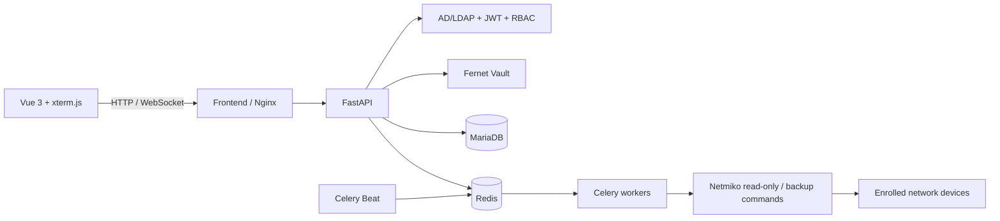

# OmniEyeNetwork

**OmniEyeNetwork** is a self-hosted network inventory and operations platform for managed switches and routers. It combines a FastAPI backend, MariaDB, Redis/Celery workers, and a Vue 3 web console.

> The application is under active development. Validate vendor commands and security settings in a lab before connecting production devices.

## Features

- Managed device, group, and port inventory with role-protected REST APIs.
- Vault-encrypted SSH credentials; credential fields are never included in device API responses.
- AD/LDAP authentication, JWT sessions, and `admin` / `operator` / `viewer` access roles.
- Netmiko-based configuration snapshots, checksum versioning, history, and diffs.
- Celery worker fan-out for bulk backups and scheduled nightly backups.
- Hourly, read-only port/VLAN/MAC discovery with database synchronization.
- On-demand live configuration retrieval for authorized operators.
- Vue 3 + TypeScript dashboard with inventory, port status, device enrollment, and config viewing.
- xterm.js command console over WebSocket, restricted server-side to each vendor's predefined read-only interface, VLAN, MAC, and version commands. It is **not** an unrestricted shell.

## Architecture



The current network command implementation uses Netmiko directly. Celery distributes per-device work to the worker pool. Nornir packages remain in the dependency set for the planned inventory-runner integration; they are not currently the active execution path.

## Requirements

- Docker Desktop with Docker Compose v2
- Python 3.11+ and Node.js 22+ only if running tests or the frontend outside Docker
- Management network reachability and verified SSH host keys for live-device operations

## Quick start (PowerShell)

1. Create the environment file:

   ```powershell
   Copy-Item .env.example .env
   ```

2. Generate fresh keys and set them in `.env`:

   ```powershell
   python -c "import base64,secrets; print(base64.urlsafe_b64encode(secrets.token_bytes(32)).decode())"
   python -c "import secrets; print(secrets.token_urlsafe(48))"
   ```

   Use the first value for `VAULT_SECRET_KEY`, the second for `SECRET_KEY`, and replace both database passwords. Do not commit `.env`. For local UI development, `.env.example` enables mock AD and network simulation; set both to `false` when testing real devices.

3. Start or update the complete stack:

   ```powershell
   docker compose up -d --build
   docker compose ps
   ```

   Database and Redis data are stored in named volumes. Do not use `docker compose down -v` unless you intentionally want to delete this data.

4. Open the dashboard at [http://localhost:3000](http://localhost:3000). Development API docs are at [http://localhost:8000/docs](http://localhost:8000/docs).

When `AD_MOCK_MODE=true`, local-only test accounts are available:

| User | Password | Role |
|---|---|---|
| `admin` | `admin123` | admin |
| `operator` | `operator123` | operator |
| `viewer` | `viewer123` | viewer |

These mock credentials are not suitable for a production environment. Production startup rejects mock AD, debug mode, weak signing keys, invalid Fernet keys, and disabled SSH host-key checking.

### SSH host-key verification

For production, set `SSH_STRICT_HOST_KEY_CHECKING=true` and configure `SSH_KNOWN_HOSTS_FILE` to a file containing the verified public host keys of the enrolled devices. The Compose stack mounts it read-only into the API and worker containers. Obtain and verify fingerprints through a trusted channel; do not trust a key merely because `ssh-keyscan` returned it. The tracked `ssh/known_hosts.example` is an empty development placeholder.

## Development and tests

Backend tests use in-memory SQLite and mock device/AD behavior:

```powershell
python -m pip install -r backend/requirements-dev.txt
python -m pytest backend/tests -q
```

Frontend development server and production checks:

```powershell
npm.cmd install --prefix frontend
npm.cmd run dev --prefix frontend
npm.cmd run build --prefix frontend
npm.cmd audit --prefix frontend
```

For the running container stack, rebuild and check service health:

```powershell
docker compose up -d --build
docker compose ps
```

The frontend is served by Nginx, which proxies `/api` and WebSocket upgrades to FastAPI. Database and Redis ports are bound to loopback by default; the API and dashboard are also local-only by default.

## Authentication and permissions

AD group-to-role mapping is configurable through `.env`:

| Role | Access |
|---|---|
| `admin` | Inventory/group/port writes, backups, live config, and read-only terminal |
| `operator` | Inventory reads, backup triggers, live config, port discovery, and read-only terminal |
| `viewer` | Inventory and port reads plus backup history; raw config and diffs are restricted |

The backend rechecks a user's current database role on every request; role changes invalidate older tokens. Browser sessions use tab-scoped `sessionStorage`. WebSocket authentication sends the JWT as the first frame rather than placing it in a URL. Terminal commands are checked against the selected vendor profile on the server.

## API overview

All application API paths are under `/api/v1`.

| Area | Routes | Access |
|---|---|---|
| Health | `GET /health` | Public, minimal status only |
| Auth | `POST /auth/login`, `GET /auth/me`, `GET /auth/roles` | Login public; profile authenticated |
| Inventory | `/devices`, `/groups`, `/ports` | Reads authenticated; mutations admin |
| Live config | `GET /devices/{id}/live-config` | Admin/operator |
| Discovery | `POST /ports/discovery/run` | Admin/operator; queued |
| Backups | `/backups` | History authenticated; config and diff admin/operator |
| Web terminal | `WS /terminal/devices/{id}` | Admin/operator; allowlisted read-only commands only |
| Vendors | `GET /vendors` | Public catalog |

Configuration snapshots may contain sensitive device data. Their full content and diffs are not available to viewers.

## Roadmap status

- [x] Phase 1 — Docker foundation, MariaDB models, CRUD API, Alembic baseline.
- [x] Phase 2 — AD/LDAP, JWT/RBAC, Vault credential encryption.
- [x] Phase 3 — Multi-vendor Netmiko profiles, configuration versioning/diff, Celery backup tasks.
- [x] Phase 4 — Scheduled port discovery, live config API, authenticated WebSocket command console.
- [x] Phase 5 — Vue dashboard, xterm.js interface, Docker/Nginx integration.

Follow-up work includes broader vendor-specific parsers, Nornir-based inventory execution, configuration redaction/retention policies, and deployment-specific TLS/secret management.

## Documentation

- [System architecture and security model](docs/ARCHITECTURE.md)
- [Changelog](CHANGELOG.md)
- [Environment template](.env.example)

## License

This project is licensed under the [MIT License](LICENSE).
