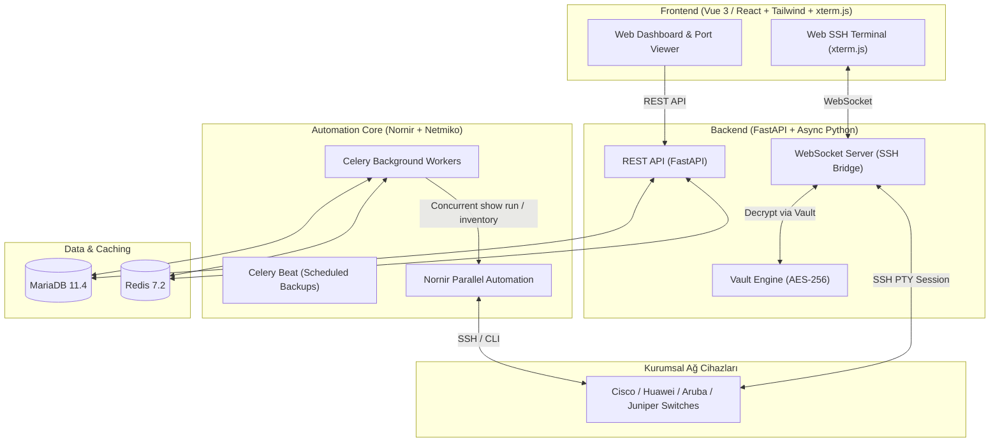

# 🌐 OmniEyeNetwork

> **Enterprise Network Management, Hybrid Real-Time Monitoring & Web SSH Automation Platform**

OmniEyeNetwork, kurumsal ağ altyapılarını yönetmek, switch/router konfigürasyonlarını otomatik olarak yedeklemek, port ve VLAN durumlarını hibrit yaklaşımla anlık izlemek ve tarayıcı üzerinden tek tıkla güvenli Web SSH bağlantısı sağlamak amacıyla geliştirilmiş yeni nesil bir ağ otomasyon platformudur.

---

## 🏗️ Mimari & Teknoloji Yığını (Tech Stack)



### 1. ⚙️ Ağ Otomasyonu (Nornir + Netmiko)
- Standart kısıtlı araçlar yerine saf Python gücü.
- Eşzamanlı (concurrency) iş parçacıkları ile yüzlerce cihazdan saniyeler içinde paralel konfigürasyon çekimi.
- Çoklu üretici desteği (Cisco IOS/NX-OS, Huawei VRP, Aruba/HP, Juniper JunOS vb.).

### 2. ⚡ Hibrit Veri Toplama
- **Veritabanı Seviyesi:** Cihazların port, VLAN, MAC ve durum bilgileri periyodik olarak arka planda çekilip MariaDB'ye kaydedilir. Arayüzde switch detayına tıklandığında bilgiler sıfır gecikmeyle veritabanından gelir.
- **Canlı Sorgu (On-Demand):** "Canlı Config Göster" butonuna basıldığında anlık olarak cihaza bağlanılır ve güncel `running-config` ekrana basılır.

### 3. 🔐 Vault & Tek Tuşla Web SSH
- Cihaz şifreleri veritabanında **AES-256** ile şifrelenmiş olarak tutulur.
- Ön yüzde **xterm.js**, arka planda FastAPI WebSocket tüneli ile tarayıcıdan SSH oturumu açılır.
- Operatör şifreyi bilmek zorunda kalmadan güvenli terminale erişir.

### 4. 👥 Güvenlik & RBAC
- Kurumsal Active Directory / LDAP entegrasyonu.
- Rol bazlı yetkilendirme (RBAC): `Network_Admins`, `Network_Operators`, `Network_Viewers`.

---

## 🗺️ Geliştirme Yol Haritası (Roadmap)

- [x] **Faz 1: Temel Altyapı ve Veritabanı (Kurulum Aşaması)**
  - [x] Docker & Docker Compose ortamı (`FastAPI`, `MariaDB`, `Redis`, `Celery Worker`).
  - [x] Veritabanı modelleri (`Device`, `DeviceGroup`, `Port`, `ConfigBackup`).
  - [x] FastAPI REST CRUD API uçları (`/devices`, `/groups`, `/ports`, `/health`).
  - [x] Alembic veritabanı migrasyon yapısı.
- [ ] **Faz 2: Güvenlik, AD Entegrasyonu ve Kasa (Vault) Yapısı**
  - [ ] Active Directory / LDAP kimlik doğrulama.
  - [ ] JWT oturum yönetimi ve RBAC rolleri.
  - [ ] AES-256 cihaz parola şifreleme/çözme Vault servisi.
- [ ] **Faz 3: Ağ Otomasyonu ve Otomatik Yedekleme (Core Engine)**
  - [ ] Nornir + Netmiko konfigürasyon çekme motoru.
  - [ ] Celery ile zamanlanmış otomatik yedekleme görevleri (Nightly Backup).
  - [ ] Konfigürasyon versiyonlama ve Diff (fark) görüntüleme altyapısı.
- [ ] **Faz 4: Veri Zenginleştirme ve Anlık İletişim**
  - [ ] Port/VLAN/MAC periyodik keşif ve senkronizasyon servisi.
  - [ ] Anlık `show running-config` API uçları.
  - [ ] WebSocket altyapısı.
- [ ] **Faz 5: Kullanıcı Arayüzü (Frontend) & Web Terminal**
  - [ ] Modern Dashboard, Switch görselleştirme ve Port Matrisi.
  - [ ] `xterm.js` Web SSH Entegrasyonu.

---

## 📂 Proje Dizin Yapısı

```text
OmniEyeNetwork/
├── backend/
│   ├── alembic/                 # Veritabanı migrasyonları
│   ├── app/
│   │   ├── api/v1/
│   │   │   ├── endpoints/
│   │   │   │   ├── health.py    # Sistem sağlık kontrolü
│   │   │   │   ├── groups.py    # Cihaz grupları CRUD
│   │   │   │   ├── devices.py   # Cihaz envanteri CRUD
│   │   │   │   └── ports.py     # Port / Interface CRUD
│   │   │   └── api.py
│   │   ├── core/
│   │   │   ├── config.py        # Ortam değişkenleri ve ayarlar
│   │   │   ├── database.py      # Async SQLAlchemy bağlantısı
│   │   │   └── celery_app.py    # Celery asenkron görev yapılandırması
│   │   ├── models/              # ORM Veritabanı Tabloları
│   │   │   ├── device_group.py
│   │   │   ├── device.py
│   │   │   ├── port.py
│   │   │   └── config_backup.py
│   │   ├── schemas/             # Pydantic DTO veri modelleri
│   │   └── main.py              # FastAPI uygulaması
│   ├── Dockerfile
│   └── requirements.txt
├── docker/
│   └── mariadb/init.sql         # DB başlatma scripti
├── .env.example
├── .gitignore
├── docker-compose.yml           # Multi-container orkestrasyonu
└── README.md
```

---

## 🚀 Hızlı Başlangıç (Docker ile Çalıştırma)

### 1. Depoyu Klonlayın ve Ortam Değişkenlerini Hazırlayın
```bash
git clone https://github.com/mertgl1/OmniEyeNetwork.git
cd OmniEyeNetwork
cp .env.example .env
```

### 2. Docker Container'larını Başlatın
```bash
docker compose up -d --build
```

### 3. Servis Durumlarını Doğrulayın
- **Swagger API Dokümantasyonu:** [http://localhost:8000/docs](http://localhost:8000/docs)
- **ReDoc Dokümantasyonu:** [http://localhost:8000/redoc](http://localhost:8000/redoc)
- **Sistem Sağlık Ucu:** [http://localhost:8000/api/v1/health](http://localhost:8000/api/v1/health)
- **MariaDB:** `localhost:3306`
- **Redis:** `localhost:6379`

### 4. Container Loglarını İnceleme
```bash
docker compose logs -f backend
```

---

## 📄 Lisans
Bu proje [MIT](LICENSE) lisansı ile lisanslanmıştır.
