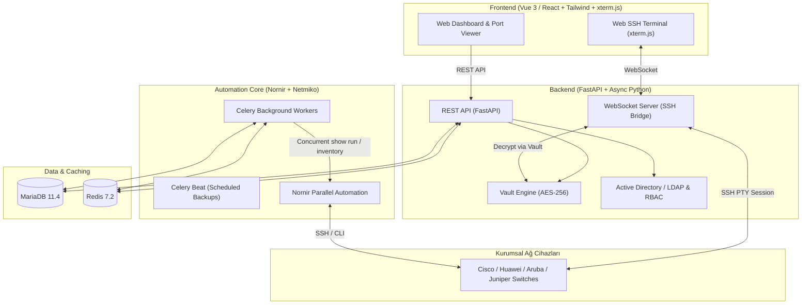

# 🌐 OmniEyeNetwork

> **Enterprise Network Management, Hybrid Real-Time Monitoring & Web SSH Automation Platform**

OmniEyeNetwork, kurumsal ağ altyapılarını yönetmek, switch/router konfigürasyonlarını otomatik olarak yedeklemek, port ve VLAN durumlarını hibrit yaklaşımla anlık izlemek ve tarayıcı üzerinden tek tıkla güvenli Web SSH bağlantısı sağlamak amacıyla geliştirilmiş yeni nesil bir ağ otomasyon platformudur.

---

## 🏗️ Mimari & Teknoloji Yığını (Tech Stack)



Detaylı teknik mimari ve ERD veritabanı şeması için: 📄 [ARCHITECTURE.md](docs/ARCHITECTURE.md)

---

## 🗺️ Geliştirme Yol Haritası (Roadmap)

- [x] **Faz 1: Temel Altyapı ve Veritabanı (Kurulum Aşaması)**
  - [x] Docker & Docker Compose ortamı (`FastAPI`, `MariaDB`, `Redis`, `Celery Worker`).
  - [x] Veritabanı modelleri (`Device`, `DeviceGroup`, `Port`, `ConfigBackup`).
  - [x] FastAPI REST CRUD API uçları (`/devices`, `/groups`, `/ports`, `/health`).
  - [x] Alembic veritabanı migrasyon yapısı.
- [x] **Faz 2: Güvenlik, AD Entegrasyonu ve Kasa (Vault) Yapısı**
  - [x] Active Directory / LDAP kimlik doğrulama servisi (`app/core/ldap.py`).
  - [x] Kurumsal grup eşleme ile RBAC rolleri (`admin`, `operator`, `viewer`).
  - [x] JWT oturum yönetimi (`/api/v1/auth/login`, `/me`, `/roles`).
  - [x] AES-256 Vault şifreleme/çözme motoru (`app/core/vault.py`).
  - [x] Cihaz şifrelerinin AES-256 ile şifrelenerek DB'ye saklanması.
  - [x] Kapsamlı otomatik test paketi (15/15 test başarılı).
- [ ] **Faz 3: Ağ Otomasyonu ve Otomatik Yedekleme (Core Engine)**
  - [ ] Nornir + Netmiko konfigürasyon çekme motoru.
  - [ ] Celery ile zamanlanmış otomatik yedekleme görevleri (Nightly Backup).
  - [ ] Konfigürasyon versiyonlama ve Diff (fark) görüntüleme altyapısı.
- [ ] **Faz 4: Veri Zenginleştirme ve Anlık İletişim**
  - [ ] Port/VLAN/MAC periyodik keşif ve senkronizasyon servisi.
  - [ ] Anlık `show running-config` API uçları.
  - [ ] WebSocket altyapısı.
- [ ] **Faz 5: Kullanıcı Arayüzü (Frontend) & Web Terminal**
  - [ ] Modern Dashboard, Switch görselleştirme ve Port Matrisi.
  - [ ] `xterm.js` Web SSH Entegrasyonu.

---

## 📂 Proje Dizin Yapısı

```text
OmniEyeNetwork/
├── backend/
│   ├── alembic/                 # Veritabanı migrasyonları
│   ├── app/
│   │   ├── api/                 # API katmanı
│   │   │   ├── deps.py          # RBAC ve JWT bağımlılıkları
│   │   │   └── v1/
│   │   │       ├── endpoints/
│   │   │       │   ├── auth.py      # AD/LDAP Login & RBAC
│   │   │       │   ├── health.py    # Sistem sağlık kontrolü
│   │   │       │   ├── groups.py    # Cihaz grupları CRUD
│   │   │       │   ├── devices.py   # Cihaz envanteri CRUD (Vault korumalı)
│   │   │       │   └── ports.py     # Port / Interface CRUD
│   │   │       └── api.py
│   │   ├── core/
│   │   │   ├── config.py        # Ortam değişkenleri ve ayarlar
│   │   │   ├── database.py      # Async SQLAlchemy bağlantısı
│   │   │   ├── security.py      # JWT & Parola hashleme
│   │   │   ├── vault.py         # AES-256 Cihaz Şifresi Kasası
│   │   │   ├── ldap.py          # Active Directory / LDAP Servisi
│   │   │   └── celery_app.py    # Celery asenkron görev yapılandırması
│   │   ├── models/              # ORM Veritabanı Tabloları
│   │   │   ├── device_group.py
│   │   │   ├── device.py
│   │   │   ├── port.py
│   │   │   ├── config_backup.py
│   │   │   └── user.py
│   │   ├── schemas/             # Pydantic DTO veri modelleri
│   │   └── main.py              # FastAPI uygulaması
│   ├── tests/                   # Otomatik Test Paketi (Pytest)
│   │   ├── conftest.py
│   │   ├── test_vault.py        # AES-256 Kasa testleri
│   │   ├── test_ldap_auth.py    # AD/LDAP & JWT testleri
│   │   └── test_api_endpoints.py# API CRUD & Auth testleri
│   ├── Dockerfile
│   ├── requirements.txt
│   └── requirements-dev.txt
├── docs/
│   └── ARCHITECTURE.md          # Detaylı mimari ve teknik şartname
├── docker/
│   └── mariadb/init.sql         # DB başlatma scripti
├── .env.example
├── .gitignore
├── docker-compose.yml           # Multi-container orkestrasyonu
├── pytest.ini
└── README.md
```

---

## 🧪 Testleri Çalıştırma

Tüm birim ve entegrasyon testlerini (SQLite asenkron bellek içi veritabanı ile hiçbir dış bağımlılık olmadan) çalıştırmak için:

```bash
python -m pytest backend/tests -v
```

Çıktı örneği:
```text
backend/tests/test_api_endpoints.py::test_auth_login_ad_mock PASSED
backend/tests/test_api_endpoints.py::test_auth_login_invalid PASSED
backend/tests/test_api_endpoints.py::test_auth_roles_list PASSED
backend/tests/test_device_groups_crud PASSED
backend/tests/test_devices_and_ports_crud PASSED
backend/tests/test_ldap_auth.py::test_ldap_authentication_admin PASSED
backend/tests/test_ldap_auth.py::test_ldap_authentication_operator PASSED
backend/tests/test_ldap_auth.py::test_ldap_authentication_viewer PASSED
backend/tests/test_ldap_auth.py::test_ldap_authentication_invalid_password PASSED
backend/tests/test_ldap_auth.py::test_password_hashing PASSED
backend/tests/test_ldap_auth.py::test_jwt_token_flow PASSED
backend/tests/test_vault.py::test_vault_encryption_and_decryption PASSED
backend/tests/test_vault.py::test_vault_empty_credentials PASSED
backend/tests/test_vault.py::test_vault_tampered_ciphertext PASSED
backend/tests/test_vault.py::test_vault_custom_key_generation PASSED

============================= 15 passed in 0.74s ==============================
```

---

## 🚀 Hızlı Başlangıç (Docker ile Çalıştırma)

Docker kurulumunuz tamamlandıktan sonra tek komutla tüm sistemi ayağa kaldırabilirsiniz:

```bash
# 1. Ortam değişkenlerini hazırlayın:
cp .env.example .env

# 2. Container'ları inşa edip başlatın:
docker compose up -d --build
```

### Servis Erişim Noktaları:
- **Swagger API Dokümantasyonu:** [http://localhost:8000/docs](http://localhost:8000/docs)
- **ReDoc Dokümantasyonu:** [http://localhost:8000/redoc](http://localhost:8000/redoc)
- **Sistem Sağlık Ucu:** [http://localhost:8000/api/v1/health](http://localhost:8000/api/v1/health)
- **MariaDB:** `localhost:3306`
- **Redis:** `localhost:6379`

### Test Kullanıcıları (Geliştirme / AD Mock Modu):
| Kullanıcı Adı | Şifre | Rol | Yetki Seviyesi |
| :--- | :--- | :--- | :--- |
| `admin` | `admin123` | `admin` | Network_Admins (Tam Yetkili) |
| `operator` | `operator123` | `operator` | Network_Operators (İşletim & Web SSH) |
| `viewer` | `viewer123` | `viewer` | Network_Viewers (Yalnızca Görüntüleme) |

---

## 📄 Lisans
Bu proje [MIT](LICENSE) lisansı ile lisanslanmıştır.
