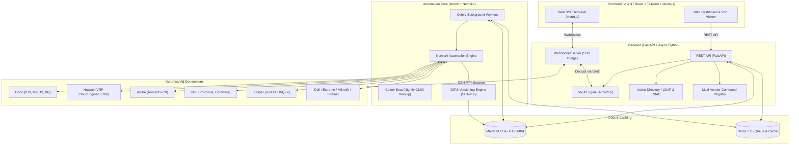

# 🌐 OmniEyeNetwork

> **Enterprise Network Management, Multi-Vendor Automation & Web SSH Platform**

[](backend/tests/)
[](https://www.python.org/)
[](https://fastapi.tiangolo.com/)
[](docker-compose.yml)
[](CHANGELOG.md)

OmniEyeNetwork, kurumsal heterojen ağ altyapılarını yönetmek, switch/router konfigürasyonlarını otomatik olarak yedeklemek, port ve VLAN durumlarını hibrit yaklaşımla anlık izlemek ve tarayıcı üzerinden tek tıkla güvenli Web SSH bağlantısı sağlamak amacıyla geliştirilmiş yeni nesil bir ağ otomasyon platformudur.

---

## 🏗️ Mimari & Teknoloji Yığını (Tech Stack)



- **Mimari Detayları ve ERD Şeması:** 📄 [docs/ARCHITECTURE.md](docs/ARCHITECTURE.md)
- **Sürüm Geçmişi ve Notları:** 📄 [CHANGELOG.md](CHANGELOG.md)

---

## 🏛️ Desteklenen Çoklu Üretici (Multi-Vendor) Komut Matrisi

OmniEyeNetwork, üretici bağımsız (vendor-neutral) bir mimariye sahiptir. Her donanım ailesi için doğru CLI sözdizimi otomatik çözümlenir:

| Üretici (Vendor) | Desteklenen Seri / Modeller | Netmiko `device_type` | Running-Config Komutu | VLAN Komutu | MAC Adres Tablosu |
| :--- | :--- | :--- | :--- | :--- | :--- |
| **Cisco IOS / XE** | Catalyst 2960, 3850, 9200, 9300, 9500, ISR 4000 | `cisco_ios` | `show running-config` | `show vlan brief` | `show mac address-table` |
| **Cisco NX-OS** | Nexus 3000, 5000, 7000, 9000 (Data Center) | `cisco_nxos` | `show running-config` | `show vlan` | `show mac address-table` |
| **Cisco IOS-XR** | ASR 9000, NCS 5500 | `cisco_xr` | `show running-config` | `show vlan` | `show l2vpn mac-learning` |
| **Huawei VRP** | CloudEngine 6800/8800/12800, S5700, S6700, AR | `huawei_vrp` | `display current-configuration` | `display vlan` | `display mac-address` |
| **ArubaOS-CX** | CX 6000, 6100, 6200, 6300, 8320 | `aruba_os` | `show running-config` | `show vlan` | `show mac-address` |
| **HPE ProCurve** | ProCurve 2530, 2920, 2930F, 5400R zl2 | `hp_procurve` | `show running-config` | `show vlans` | `show mac-address` |
| **HPE Comware** | FlexFabric 5900, 5940, 12500, H3C S5500 | `hp_comware` | `display current-configuration` | `display vlan all` | `display mac-address` |
| **Juniper JunOS** | EX2300, EX3400, EX4300, QFX5100, SRX | `juniper_junos` | `show configuration` | `show vlans` | `show ethernet-switching table` |
| **Dell OS10** | PowerSwitch S4100, S5200, Z9264F | `dell_os10` | `show running-configuration` | `show vlan` | `show mac-address-table` |
| **Extreme EXOS** | Summit X440, X460, X670 | `extreme_exos` | `show configuration` | `show vlan` | `show fdb` |
| **MikroTik** | RouterOS & Cloud Router Switches (CRS) | `mikrotik_routeros` | `/export verbose` | `/interface bridge vlan print` | `/interface bridge host print` |
| **Fortinet** | FortiSwitch 124/248/448, FortiOS | `fortinet` | `show full-configuration` | `diagnose switch vlan list` | `diagnose switch mac-address list`|

---

## 🗺️ Geliştirme Yol Haritası (Roadmap)

- [x] **Faz 1: Temel Altyapı ve Veritabanı (Kurulum Aşaması)**
  - [x] Docker & Docker Compose ortamı (`FastAPI`, `MariaDB`, `Redis`, `Celery Worker`).
  - [x] Veritabanı modelleri (`Device`, `DeviceGroup`, `Port`, `ConfigBackup`, `User`).
  - [x] FastAPI REST CRUD API uçları (`/devices`, `/groups`, `/ports`, `/health`).
  - [x] Alembic veritabanı migrasyon yapısı.
- [x] **Faz 2: Güvenlik, AD Entegrasyonu ve Kasa (Vault) Yapısı**
  - [x] Active Directory / LDAP kimlik doğrulama servisi (`app/core/ldap.py`).
  - [x] Kurumsal grup eşleme ile RBAC rolleri (`admin`, `operator`, `viewer`).
  - [x] JWT oturum yönetimi (`/api/v1/auth/login`, `/me`, `/roles`).
  - [x] AES-256 Vault şifreleme/çözme motoru (`app/core/vault.py`).
  - [x] Cihaz şifrelerinin AES-256 ile şifrelenerek DB'ye saklanması.
- [x] **Faz 3: Ağ Otomasyonu, Çoklu Üretici ve Yedekleme (Core Engine)**
  - [x] 12 farklı üretici ailesini kapsayan `VendorProfileRegistry` komut matrisi.
  - [x] Netmiko / SSH tabanlı çoklu üretici konfigürasyon çekme motoru (`automation_engine.py`).
  - [x] SHA-256 Checksum ile akıllı tekilleştirme (aynı konfigürasyonda mükerrer kayıt engeli).
  - [x] Satır bazlı Unix Unified Diff motoru (`diff_service.py`).
  - [x] Celery asenkron yedekleme görevleri ve Celery Beat gece yedekleme takvimi.
  - [x] Yedekleme tetikleme, geçmiş inceleme ve Diff karşılaştırma REST API uçları (`/api/v1/backups`).
  - [x] Desteklenen üretici/model kataloğu API ucu (`/api/v1/vendors`).
  - [x] Kapsamlı otomatik test paketi (**23/23 test başarılı**).
- [ ] **Faz 4: Veri Zenginleştirme ve Anlık İletişim**
  - [ ] Port/VLAN/MAC periyodik keşif ve senkronizasyon servisi.
  - [ ] Anlık `show running-config` API uçları.
  - [ ] WebSocket altyapısı.
- [ ] **Faz 5: Kullanıcı Arayüzü (Frontend) & Web Terminal**
  - [ ] Modern Dashboard, Switch görselleştirme ve Port Matrisi.
  - [ ] `xterm.js` Web SSH Entegrasyonu.

---

## 🧪 Testleri Çalıştırma

Tüm birim ve entegrasyon testlerini hiçbir dış bağımlılık gerekmeden (SQLite bellek içi motoru ile) anında çalıştırmak için:

```bash
python -m pytest backend/tests -v
```

Çıktı özeti:
```text
backend/tests/test_api_endpoints.py::test_auth_login_ad_mock PASSED      [  4%]
backend/tests/test_api_endpoints.py::test_auth_login_invalid PASSED      [  8%]
backend/tests/test_api_endpoints.py::test_auth_roles_list PASSED         [ 13%]
backend/tests/test_api_endpoints.py::test_device_groups_crud PASSED      [ 17%]
backend/tests/test_api_endpoints.py::test_devices_and_ports_crud PASSED  [ 21%]
backend/tests/test_backup_and_diff.py::test_sha256_calculation PASSED    [ 26%]
backend/tests/test_backup_and_diff.py::test_unified_diff_generation PASSED [ 30%]
backend/tests/test_backup_and_diff.py::test_unified_diff_identical PASSED [ 34%]
backend/tests/test_backup_and_diff.py::test_vendor_api_endpoints PASSED  [ 39%]
backend/tests/test_backup_and_diff.py::test_backup_and_diff_flow PASSED  [ 43%]
backend/tests/test_ldap_auth.py::test_ldap_authentication_admin PASSED   [ 47%]
backend/tests/test_ldap_auth.py::test_ldap_authentication_operator PASSED [ 52%]
backend/tests/test_ldap_auth.py::test_ldap_authentication_viewer PASSED  [ 56%]
backend/tests/test_ldap_auth.py::test_ldap_authentication_invalid_password PASSED [ 60%]
backend/tests/test_ldap_auth.py::test_password_hashing PASSED            [ 65%]
backend/tests/test_ldap_auth.py::test_jwt_token_flow PASSED              [ 69%]
backend/tests/test_vault.py::test_vault_encryption_and_decryption PASSED [ 73%]
backend/tests/test_vault.py::test_vault_empty_credentials PASSED         [ 78%]
backend/tests/test_vault.py::test_vault_tampered_ciphertext PASSED       [ 82%]
backend/tests/test_vault.py::test_vault_custom_key_generation PASSED     [ 86%]
backend/tests/test_vendor_profiles.py::test_all_vendor_profiles_configured PASSED [ 91%]
backend/tests/test_vendor_profiles.py::test_vendor_heuristic_resolution PASSED [ 95%]
backend/tests/test_vendor_profiles.py::test_list_supported_vendors PASSED [100%]

============================= 23 passed in 0.83s ==============================
```

---

## 🚀 Hızlı Başlangıç (Docker ile Çalıştırma)

```bash
# 1. Ortam değişkenlerini hazırlayın:
cp .env.example .env

# 2. Container'ları başlatın:
docker compose up -d --build
```

### Servis Erişim Noktaları:
- **Swagger API Dokümantasyonu:** [http://localhost:8000/docs](http://localhost:8000/docs)
- **ReDoc Dokümantasyonu:** [http://localhost:8000/redoc](http://localhost:8000/redoc)
- **Sistem Sağlık Ucu:** [http://localhost:8000/api/v1/health](http://localhost:8000/api/v1/health)
- **Çoklu Üretici Kataloğu:** [http://localhost:8000/api/v1/vendors](http://localhost:8000/api/v1/vendors)
- **Yedekleme & Diff Uçları:** [http://localhost:8000/api/v1/backups](http://localhost:8000/api/v1/backups)

---

## 📄 Lisans
Bu proje [MIT](LICENSE) lisansı ile lisanslanmıştır.
