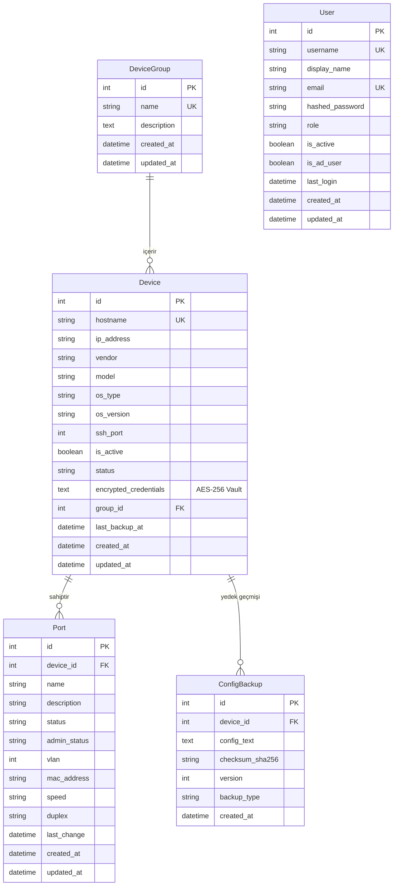

# 🏛️ OmniEyeNetwork Architecture & System Specifications

> **Versiyon:** 1.0.0 (Faz 1 & Faz 2 Tamamlandı)  
> **Durum:** Aktif Geliştirme

---

## 1. Genel Bakış & Hedefler

OmniEyeNetwork; heterojen kurumsal ağ altyapılarında (Cisco, Huawei, Aruba, Juniper vb.) çalışan yüzlerce switch ve router'ın:
1. **Envanter ve Port Takibini** (VLAN, MAC, Up/Down, Speed) veritabanı önbelleği ile gecikmesiz sunan,
2. **Kritik Konfigürasyonlarını** (running-config) Nornir tabanlı eşzamanlı Python motoru ile otomatik yedekleyen ve versiyonlayan,
3. **Cihaz Parolalarını** veritabanında AES-256 şifreli Vault yapısında koruyan,
4. **Active Directory / LDAP** entegrasyonu ile Rol Bazlı Erişim Kontrolü (RBAC) sağlayan,
5. Tarayıcıdan tek tıkla cihazın şifresini operatöre göstermeden güvenli **Web SSH Terminali (xterm.js)** açan,

uçtan uca entegre ve kurumsal düzeyde bir ağ yönetim platformudur.

---

## 2. Sistem Mimarisi & Servisler

```mermaid
flowchart TB
    subgraph ClientTier["Kullanıcı Katmanı (Frontend)"]
        Browser["Modern Web UI (Vue 3 / React + Tailwind CSS)"]
        WebSSH["xterm.js Web Terminal"]
    end

    subgraph APITier["Uygulama & API Katmanı (FastAPI)"]
        REST["REST API Engine (/api/v1)"]
        AuthModule["Auth & RBAC Service (AD/LDAP + JWT)"]
        VaultModule["Vault Cryptography Engine (AES-256)"]
        WSServer["WebSocket Bridge Server"]
    end

    subgraph AutomationTier["Otomasyon & Arka Plan (Celery + Nornir)"]
        CeleryWorker["Celery Worker Engine"]
        CeleryBeat["Celery Beat (Zamanlanmış Görevler)"]
        NornirCore["Nornir Concurrent Runner"]
        NetmikoDrivers["Netmiko Multi-Vendor Drivers"]
    end

    subgraph PersistenceTier["Veri & Kuyruk Katmanı"]
        MariaDB[(MariaDB 11.4 - UTF8MB4)]
        Redis[(Redis 7.2 - Cache & Broker)]
    end

    subgraph NetworkTier["Fiziksel / Sanal Ağ Cihazları"]
        CoreSW["Omurga Switch'ler (Core/Distribution)"]
        AccessSW["Kenar Switch'ler (Access Layer)"]
        Routers["Router & Güvenlik Duvarları"]
    end

    Browser -->|HTTPS / REST API| REST
    WebSSH <-->|WSS (WebSockets)| WSServer
    REST --> AuthModule
    REST --> VaultModule
    REST <--> MariaDB
    REST <--> Redis

    WSServer --> VaultModule
    WSServer <-->|SSH (PTY Stream)| NetworkTier

    CeleryBeat -->|Zamanlanmış Backup| Redis
    Redis --> CeleryWorker
    CeleryWorker --> MariaDB
    CeleryWorker --> NornirCore
    NornirCore --> NetmikoDrivers
    NetmikoDrivers <-->|SSH / CLI Scrape| NetworkTier
```

---

## 3. Güvenlik & Kasa (Vault) Mimarisi

### 3.1 AES-256 Fernet Şifreleme
- Cihazlara ait SSH kullanıcı adı, şifresi ve `enable_secret` parolaları **kesinlikle açık metin olarak veritabanına yazılmaz**.
- Parolalar, 256-bit AES şifreleme ve PBKDF2HMAC (SHA-256) ile türetilen simetrik Fernet anahtarı ile şifrelenir (`app.core.vault.VaultEngine`).
- Kullanıcı API üzerinden cihaz bilgilerini sorguladığında şifreler DTO yanıtlarında (`DeviceResponse`) asla yer almaz.
- Şifre sadece sistem arka planında Web SSH bağlantısı veya Nornir yedekleme motoru çalışırken bellek üzerinde anlık olarak çözülür.

### 3.2 Active Directory Entegrasyonu ve RBAC
Kullanıcılar kurumsal etki alanı hesaplarıyla sisteme giriş yaparlar:

| AD Güvenlik Grubu | Sistem Rolü | İzinler & Yetkiler |
| :--- | :--- | :--- |
| `Network_Admins` | `admin` | Cihaz CRUD, Grup yönetimi, Web SSH, Canlı Config alma, Konfigürasyon değiştirme, Kullanıcı rolleri. |
| `Network_Operators` | `operator` | Web SSH terminal erişimi, Canlı Config görüntüleme, Port durumlarını inceleme ve anlık sorgulama. |
| `Network_Viewers` | `viewer` | Yalnızca okuma (Read-only); Envanter listesi, port durumları ve geçmiş konfigürasyon yedekleri. |

---

## 4. Veritabanı Modelleri İlişki Şeması (ERD)



---

## 5. API Uç Noktaları Özeti (`/api/v1`)

### Kimlik Doğrulama & Yetkilendirme (`/auth`)
- `POST /api/v1/auth/login`: AD/LDAP veya yerel hesapla oturum açma, JWT döndürür.
- `GET /api/v1/auth/me`: Giriş yapmış kullanıcının bilgileri ve aktif rolü.
- `GET /api/v1/auth/roles`: Sistemdeki RBAC rolleri ve açıklamaları.

### Sağlık Kontrolü (`/health`)
- `GET /api/v1/health`: FastAPI, MariaDB ve Redis canlılık kontrolleri.

### Cihaz Grupları (`/groups`)
- `GET /api/v1/groups`: Grup listeleme (sayfalama destekli).
- `POST /api/v1/groups`: Yeni cihaz grubu oluşturma.
- `GET /api/v1/groups/{id}`: Grup detayı.
- `PUT /api/v1/groups/{id}`: Grup güncelleme.
- `DELETE /api/v1/groups/{id}`: Grup silme.

### Ağ Cihazları (`/devices`)
- `GET /api/v1/devices`: Cihaz listesi (üretici, grup, aktiflik filtreleri).
- `POST /api/v1/devices`: Cihaz ekleme (parolalar Vault ile şifrelenir).
- `GET /api/v1/devices/{id}`: Cihaz detayı.
- `PUT /api/v1/devices/{id}`: Cihaz güncelleme.
- `DELETE /api/v1/devices/{id}`: Cihaz silme.

### Port & Arayüzler (`/ports`)
- `GET /api/v1/ports`: Switch portları listeleme (cihaz ve VLAN filtresi).
- `POST /api/v1/ports`: Port kaydı oluşturma.
- `GET /api/v1/ports/{id}`: Port detayı.
- `PUT /api/v1/ports/{id}`: Port durumu/VLAN güncelleme.
- `DELETE /api/v1/ports/{id}`: Port kaydı silme.
