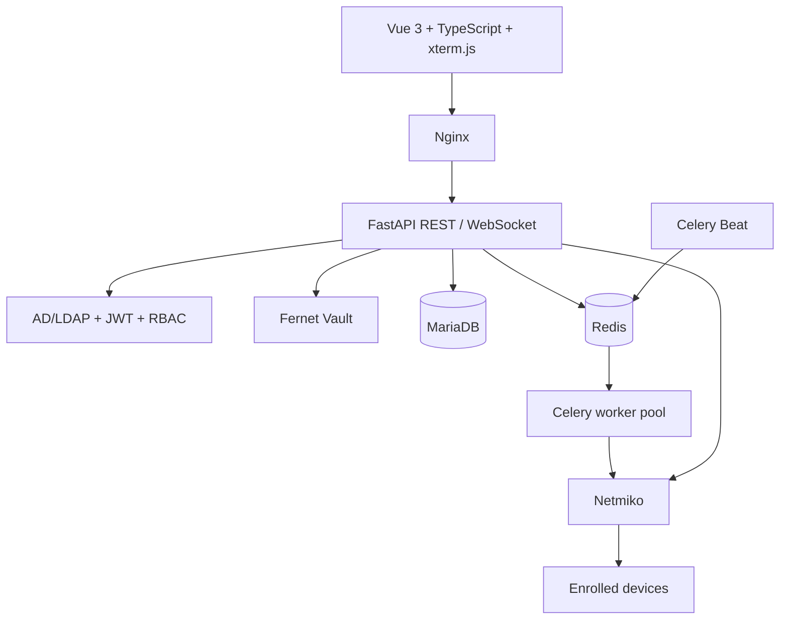
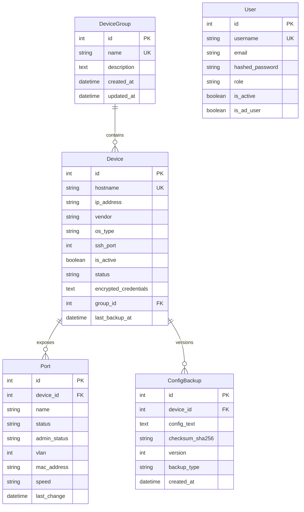

# OmniEyeNetwork — Architecture and Security

**Version:** 0.5.0
**Status:** Active development

## 1. System overview

OmniEyeNetwork contains a Vue 3 single-page application, FastAPI API, MariaDB persistence layer, Redis broker, Celery worker pool, and Celery Beat scheduler. The frontend's Nginx container serves static assets and proxies API and WebSocket traffic to the backend.

Network operations use Netmiko and vendor profiles. Celery tasks fan out work by device across workers. Nornir is present as a dependency but is not currently used by the execution engine.

## 2. Data model

Alembic runs before the backend starts. The initial baseline migration creates missing tables and leaves existing SQLAlchemy-created tables and data intact. Application startup also calls `create_all` as a compatibility safety net; future schema changes should be implemented as new Alembic revisions.

## 3. Network inventory and automation

- Device records are enrolled by an administrator. SSH credentials are encrypted before persistence.
- Vendor profiles provide the driver and read-only commands for interface state, VLANs, MAC tables, version, and configuration retrieval.
- Port discovery is dispatched to Celery and scheduled hourly. It parses supported common CLI layouts and upserts interface status/VLAN/MAC attributes. Unsupported output layouts can produce incomplete data; vendor-specific parser tests should accompany new profiles.
- Manual configuration retrieval uses the live-config API. Backups are versioned by SHA-256; bulk and scheduled backups fan out across Celery workers.
- Live connections run in a thread rather than blocking the async API event loop.
- A failed SSH connection is reported as a failure. Simulated data is used only in explicit simulation mode or tests.

## 4. Authentication and authorization

Users authenticate through Active Directory/LDAP or a local account. LDAP filters escape user input and LDAPS validates server certificates. AD group names map to `admin`, `operator`, or `viewer`.

| Role | Permissions |
|---|---|
| `admin` | Manage inventory/groups/ports; queue backups and discovery; view live config, backup content/diffs, and use the read-only command console |
| `operator` | Read inventory; queue backup/discovery; view live config and backup content/diffs; use the read-only command console |
| `viewer` | Read inventory, ports, and backup history; no configuration payloads or terminal access |

Protected API routes verify the JWT, load the active user, and compare the token role to the current database role. Password hashes use PBKDF2-HMAC-SHA256; legacy salted SHA-256 hashes are verified and upgraded at the next successful local login.

## 5. Vault and sensitive data

- Credentials use Fernet (AES-128-CBC plus HMAC-SHA256) with a valid URL-safe 32-byte key; the backend never serializes credential fields into `DeviceResponse`.
- Production startup requires a valid Fernet key, a sufficiently long JWT signing secret, mock authentication disabled, debug disabled, and SSH host-key checking enabled.
- Older development installations with an invalid Fernet key retain the legacy PBKDF2 derivation for compatibility and emit a critical log. It is not accepted in production; migrate encrypted records to a generated key before promoting such an installation.
- Configuration snapshots can include secrets. Only admins/operators can retrieve full snapshots or diffs; viewers can access history metadata.
- Never log passwords, tokens, decrypted credentials, or full device configurations.

## 6. WebSocket command console

Endpoint: `WS /api/v1/terminal/devices/{device_id}`.

1. The browser opens a same-origin socket and sends a JWT in the first JSON frame.
2. The server checks the configured `Origin`, token expiry, current active user, role, and active device inventory record.
3. The server decrypts credentials in memory only.
4. Only exact commands from the device's vendor profile for interface, VLAN, MAC, and version queries are accepted. Arbitrary CLI input, configuration changes, and shell commands are rejected.
5. Output is bounded and returned to xterm.js. Credentials are never sent to the browser.

The feature is a constrained, read-only command console, not an unrestricted Web SSH shell.

## 7. Scheduled jobs and services

- Celery Beat dispatches configuration backups daily at 03:00 in `CELERY_TIMEZONE` (default `Europe/Istanbul`).
- Celery Beat dispatches port discovery hourly.
- Worker concurrency is configured with `CELERY_CONCURRENCY` (default `8`).
- MariaDB and Redis use named Docker volumes. Their host ports bind to loopback by default.
- The Compose stack does not terminate HTTPS. Production deployments must provide TLS, managed secrets, network segmentation, backups, monitoring, and a trusted SSH `known_hosts` file.

## 8. API surface

Base path: `/api/v1`.

| Route | Purpose |
|---|---|
| `/health` | Minimal dependency health response |
| `/auth/login`, `/auth/me`, `/auth/roles` | Authentication and role metadata |
| `/devices`, `/groups`, `/ports` | Inventory CRUD, role protected |
| `/devices/{id}/live-config` | On-demand live config for admins/operators |
| `/ports/discovery/run` | Queue port discovery |
| `/backups/devices/{id}/run`, `/backups/run-all` | Manual/scheduled backup processing |
| `/backups/devices/{id}` | Backup history metadata |
| `/backups/{id}`, `/backups/diff/compare` | Sensitive config content and diff |
| `/vendors` | Vendor profile catalog |
| `/terminal/devices/{id}` (WebSocket) | Allowlisted read-only command stream |

Interactive OpenAPI documentation is enabled outside production and disabled in production.

## 9. Change and validation expectations

- Add an Alembic revision for every schema change; do not modify the database volume manually.
- Add parser tests for each vendor output format and mock all external device connections in unit tests.
- Run backend tests, frontend type-check/build, `npm audit`, Compose validation, and container health checks before release.
- Never run `docker compose down -v` as a routine update command.
