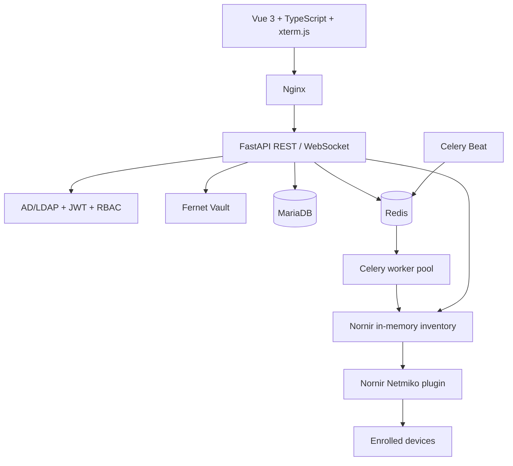
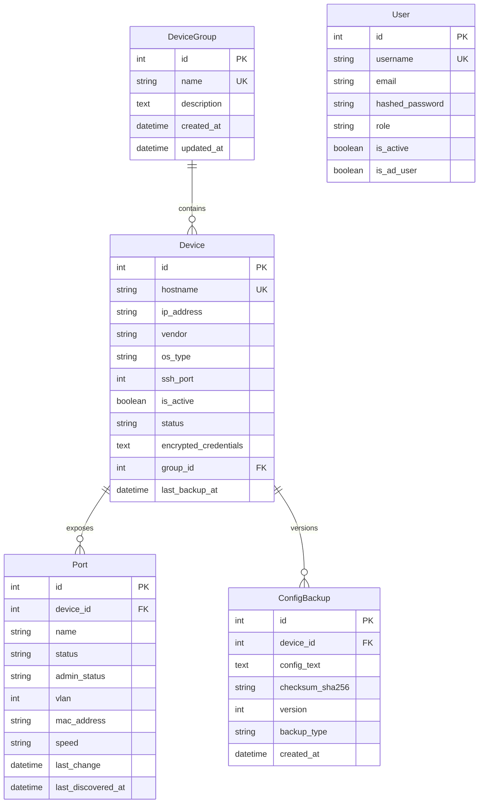

# OmniEyeNetwork — Architecture and Security

**Version:** 0.5.0
**Status:** Active development

## 1. System overview

OmniEyeNetwork contains a Vue 3 single-page application, FastAPI API, MariaDB persistence layer, Redis broker, Celery worker pool, and Celery Beat scheduler. The frontend's Nginx container serves static assets and proxies API and WebSocket traffic to the backend.

Network operations use Nornir with an in-memory inventory and the Nornir Netmiko connection plugin. Device credentials are decrypted in process memory and are not persisted in inventory files or included in Celery task arguments. Nornir's threaded runner bounds concurrent sessions through `NORNIR_NUM_WORKERS`; Celery isolates bulk work from HTTP requests.

## 2. Data model

Alembic runs before the backend starts. The initial baseline migration creates missing tables and leaves existing SQLAlchemy-created tables and data intact. Application startup also calls `create_all` as a compatibility safety net; future schema changes should be implemented as new Alembic revisions.

## 3. Network inventory and automation

- Device records are enrolled by an administrator. SSH credentials are encrypted before persistence.
- Vendor profiles provide the driver and read-only commands for interface state, VLANs, MAC tables, version, and configuration retrieval.
- Port discovery is dispatched to Celery and scheduled hourly. Vendor-keyed parsers cover all 12 declared profiles with sanitized synthetic fixtures. An output layout that yields no recognizable interfaces is reported as unsupported instead of a successful empty inventory.
- Each successfully discovered port records `last_discovered_at`. The dashboard's switch view displays cached state with that timestamp; hover/focus never opens a device connection.
- The port grid is sized from discovered interface records, with a searchable list alternative. No fixed 24/48-port hardware assumption is made.
- Admins/operators can explicitly request one interface's live config. Cisco IOS/NX-OS/XR, Huawei VRP, ArubaOS-CX, HPE ProCurve/Comware, Dell OS10, and Juniper JunOS use bounded stanza extraction; unsupported profiles or ambiguous output return an explicit error rather than full-device config.
- Manual and live configuration retrieval use Nornir/Netmiko. Bulk and scheduled backup batches execute concurrently through Nornir; an individual device failure does not discard successful results from other devices.
- Async API connections run outside the event loop. Threaded Nornir work is bounded by `NORNIR_NUM_WORKERS` (default 20, maximum 100).
- A failed SSH connection is reported as a failure. Simulated data is used only in explicit simulation mode or tests.

## 4. Authentication and authorization

Users authenticate through Active Directory/LDAP or a local account. LDAP filters escape user input and LDAPS validates server certificates. AD group names map to `admin`, `operator`, or `viewer`.

| Role | Permissions |
|---|---|
| `admin` | Manage inventory/groups/ports; queue backups and discovery; view live config, backup content/diffs, and use the read-only command console |
| `operator` | Read inventory; queue backup/discovery; view live config and backup content/diffs; use the read-only command console |
| `viewer` | Read inventory, ports, and backup history; no configuration payloads or terminal access |

Protected API routes verify the JWT, load the active user, and compare the token role to the current database role. Password hashes use PBKDF2-HMAC-SHA256; legacy salted SHA-256 hashes are verified and upgraded at the next successful local login.

## 5. Vault and sensitive data

- Credentials use Fernet (AES-128-CBC plus HMAC-SHA256) with a valid URL-safe 32-byte key; the backend never serializes credential fields into `DeviceResponse`.
- Production startup requires a valid Fernet key, a sufficiently long JWT signing secret, mock authentication disabled, debug disabled, and SSH host-key checking enabled.
- Older development installations with an invalid Fernet key retain the legacy PBKDF2 derivation for compatibility and emit a critical log. It is not accepted in production; migrate encrypted records to a generated key before promoting such an installation.
- For an existing MariaDB volume, the mounted DB password secret must match the current database user's password; changing the secret file alone does not rotate the database credential. Rotate the Vault key only with a planned credential re-encryption procedure.
- New snapshots are redacted before persistence and checksum calculation; live config responses receive the same redaction. Common password, secret, key, SNMP community, token, and key/value assignment forms are masked. Pattern-based redaction cannot guarantee discovery of every vendor's secret syntax; add sanitized fixtures for new syntax.
- Live interface config is returned only to admins/operators after checking that the requested port belongs to the requested device. The backend extracts the selected vendor stanza before redaction and never returns the whole running configuration from this endpoint.
- Historical snapshots are deliberately left unchanged. Admins can use `GET /api/v1/backups/audit/redaction` to scan paginated metadata about potential secret-bearing lines; the endpoint never returns configuration text or secret values.
- Only admins/operators can retrieve stored snapshot content or diffs; viewers can access history metadata.
- Daily retention deletes backups older than `BACKUP_RETENTION_DAYS` (default 30), except the newest `BACKUP_MIN_VERSIONS` per device (default 10), which are always preserved. This does not rewrite or re-redact legacy backups.
- Never log passwords, tokens, decrypted credentials, or full device configurations.

## 6. WebSocket command console

Endpoint: `WS /api/v1/terminal/devices/{device_id}`.

1. The browser opens a same-origin socket and sends a JWT in the first JSON frame.
2. The server checks the configured `Origin`, token expiry, current active user, role, and active device inventory record.
3. The server decrypts credentials in memory only.
4. Only exact commands from the device's vendor profile for interface, VLAN, MAC, and version queries are accepted. Arbitrary CLI input, configuration changes, and shell commands are rejected.
5. Output is bounded and returned to xterm.js. Credentials are never sent to the browser.

The feature is a constrained, read-only command console, not an unrestricted Web SSH shell.

## 7. Scheduled jobs and services

- Celery Beat dispatches configuration backups daily at 03:00 in `CELERY_TIMEZONE` (default `Europe/Istanbul`).
- Celery Beat dispatches port discovery hourly.
- Celery Beat runs backup retention daily at 04:00 in `CELERY_TIMEZONE`.
- Worker concurrency is configured with `CELERY_CONCURRENCY` (default `8`).
- Nornir thread concurrency within one batch is configured with `NORNIR_NUM_WORKERS` (default `20`, range 1–100).
- MariaDB and Redis use named Docker volumes. Their host ports bind to loopback by default.
- The default Compose stack serves local HTTP. `docker-compose.secrets.yml` mounts DB, Vault, JWT, and DB-root values as Compose secrets. `docker-compose.tls.yml` adds bundled Nginx TLS termination using read-only TLS secrets; alternatively, terminate TLS at a trusted external reverse proxy and keep the frontend HTTP upstream loopback-only.
- Compose secrets are file-backed on local deployments; production installations may replace them with their organization's secret manager. Do not commit secret files or TLS private keys.
- Production deployments must also provide network segmentation, database backups, monitoring, and a trusted SSH `known_hosts` file.

## 8. API surface

Base path: `/api/v1`.

| Route | Purpose |
|---|---|
| `/health` | Minimal dependency health response |
| `/auth/login`, `/auth/me`, `/auth/roles` | Authentication and role metadata |
| `/devices`, `/groups`, `/ports` | Inventory CRUD, role protected |
| `/devices/{id}/live-config` | On-demand live config for admins/operators |
| `/devices/{id}/ports/{port_id}/live-config` | Explicit, redacted interface-scoped live config for admins/operators; supported vendor formats only |
| `/ports/discovery/run` | Queue port discovery |
| `/backups/devices/{id}/run`, `/backups/run-all` | Manual/scheduled backup processing |
| `/backups/devices/{id}` | Backup history metadata |
| `/backups/{id}`, `/backups/diff/compare` | Sensitive config content and diff |
| `/backups/audit/redaction` | Admin-only, paginated metadata-only report for legacy snapshots |
| `/vendors` | Vendor profile catalog |
| `/terminal/devices/{id}` (WebSocket) | Allowlisted read-only command stream |

Interactive OpenAPI documentation is enabled outside production and disabled in production.

## 10. Next planned capability

Firewall device support follows the switch port-view work. Before implementation,
confirm supported firewall vendors/models and whether the first release includes
only inventory/telemetry or also policy visibility. Firewall-specific commands
and parsers are intentionally outside the current switch-view scope.

## 11. Change and validation expectations

- Add an Alembic revision for every schema change; do not modify the database volume manually.
- Add sanitized parser tests for each vendor output format and mock all external device connections in unit tests.
- Run backend tests, frontend type-check/build, `npm audit`, Compose validation, and container health checks before release.
- Never run `docker compose down -v` as a routine update command.
